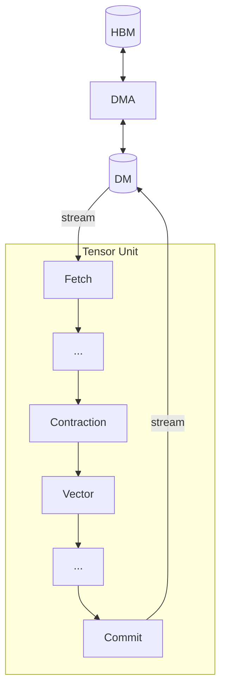

# Moving Tensors

Use this chapter when a kernel must stage data between memory tiers or turn a buffer into a Tensor Unit stream.

This chapter covers movement between HBM and DM through three dedicated engines:
- **[Fetch](./fetch-engine.md)**: DM → Tensor Unit stream
- **[Commit](./commit-engine.md)**: Tensor Unit stream → DM
- **[DMA](./dma-engine.md)**: HBM ↔ HBM, HBM ↔ DM, or DM ↔ DM

The public `dma_gather_unscaled` contract accepts a `DmTensor` index, reads raw row positions
rather than scaled byte offsets, and uses `to_dm` staging in the example. Its scatter counterpart
is not yet implemented. See the [DMA gather example](./dma-engine.md#scatter-and-gather).

TRF and VRF are populated by Tensor Unit primitives rather than dedicated move engines, and are covered in [Computing Tensors](../computing-tensors/index.md).

The APIs expose the decisions a kernel author controls: which engine moves each tensor and how axes map to hardware dimensions.
The compiler translates these declarations into low-level hardware concerns such as memory bank scheduling, stride calculation, and access alignment.

The [Sequencer](./sequencer.md) is the shared mechanism all three engines use to convert between memory buffers and packet streams.
[Memory Performance](./memory-performance.md) covers how the choice of engine and axis mapping affects bandwidth utilization.
