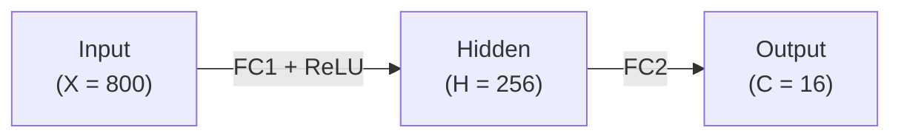
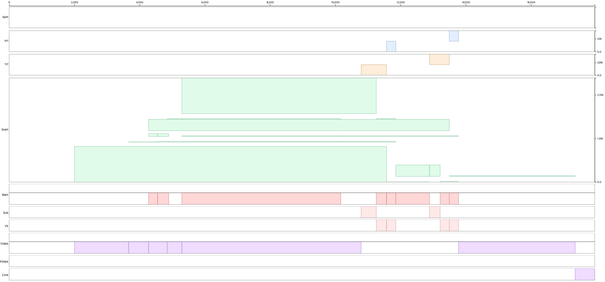
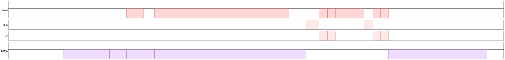
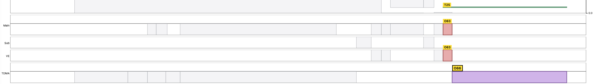
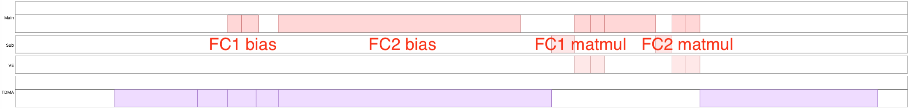
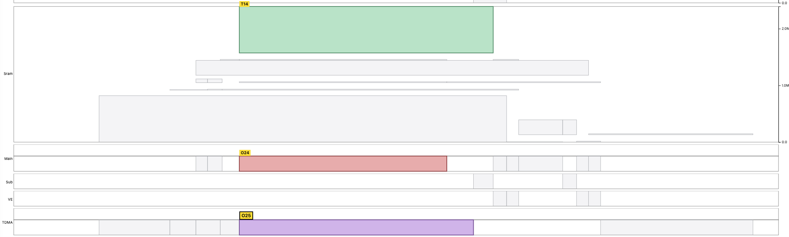
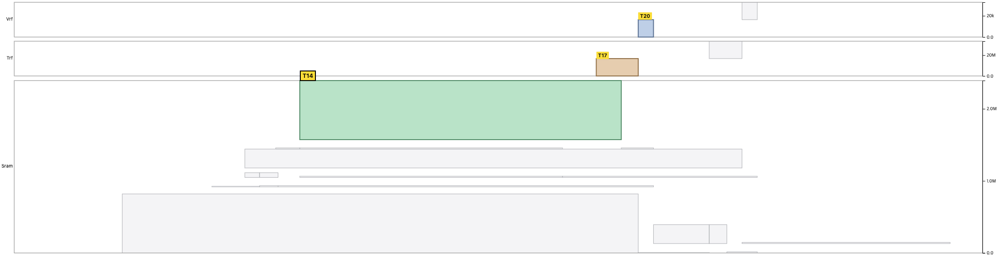

# Schedule

The scheduler organizes operations from the contexts, written operation order, and memory locations supplied by the kernel, while preserving the dependencies needed for sequentially equivalent results.

## Execution contexts

The public execution contexts are:

- **Main** (`ctx.main`): drives the main Tensor Unit pipeline.
- **Sub** (`ctx.sub`): drives the subset of the Tensor Unit pipeline used by operations such as register-file preloads.
- **DMA** (`ctx.tdma`): drives tensor movement between HBM, DM, and other memory tiers.

Operations in one context are ordered. In the MNIST schedule, operations in different contexts overlap when they do not share a scheduling resource or violate a memory dependency. For example, a DMA load overlaps main-context computation until the consumer needs the loaded value.

The [MNIST example](https://github.com/furiosa-ai/furiosa-opt/blob/main/furiosa-opt-examples/src/mnist/mod.rs) demonstrates a two-layer MLP whose first layer applies ReLU. Its schedule images show context overlap and waits:



The device function calls the two layers in source order; each layer prepares its operands in the memory tier required by its compute path:

```rust,ignore
axes![X = 800, H = 256, C = 16];

type Chip = m![1];
type Cluster = m![1 # 2];

#[device(chip = 1)]
pub fn forward(
    ctx: &mut Context,
    input: &HbmTensor<bf16, Chip, m![X]>,
    fc1_weight: &HbmTensor<bf16, Chip, m![H, X]>,
    fc1_bias: &HbmTensor<bf16, Chip, m![H]>,
    fc2_weight: &HbmTensor<bf16, Chip, m![C, H]>,
    fc2_bias: &HbmTensor<bf16, Chip, m![C]>,
) -> HbmTensor<bf16, Chip, m![C]> {
    let hidden = fc1_relu(ctx, input, fc1_weight, fc1_bias);
    fc2(ctx, hidden, fc2_weight, fc2_bias)
}
```

Each fully connected layer computes a matrix-vector product and adds a bias. The first layer also applies ReLU in the same pass.

The complete schedule is shown here; the following images zoom into its context and dependency behavior.







## Operation order


The scheduler may order independent operations to expose overlap. In the MNIST schedule, bias preparation can precede a matrix-vector operation while a long input fetch is in flight. A dependency prevents reordering when the changed order could alter a value.





Do not infer a performance improvement from written source order. Inspect the emitted schedule and compare its makespan under the [tuning protocol](./tuning.md).

## Memory dependencies

Tensor Unit operations cannot consume HBM tensors directly; data must move through the memory tiers described in [Quick Start](../quick-start.md#mapping-and-memory). Memory locations are shared by contexts, so the scheduler must preserve these hazards:

- **Read after write**: a consumer waits for the producer's write.
- **Write after read**: a later writer waits until earlier readers finish.
- **Write after write**: overlapping writes retain their program order.

These hazards explain why independent contexts sometimes wait even when their operation types differ.




## Resource conflicts

Different contexts still serialize when they require the same scheduling resource. For example, a main-context Vector Engine operation and a sub-context Vector Engine operation cannot occupy that resource simultaneously. A diagnosis must distinguish this resource wait from a data dependency before choosing a tuning lever.
